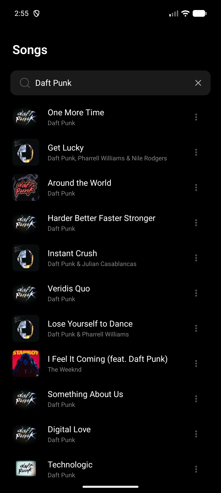
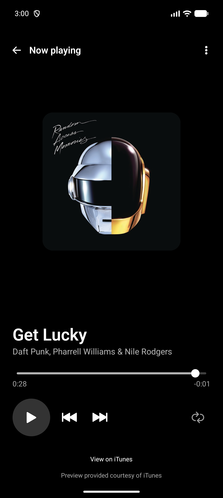
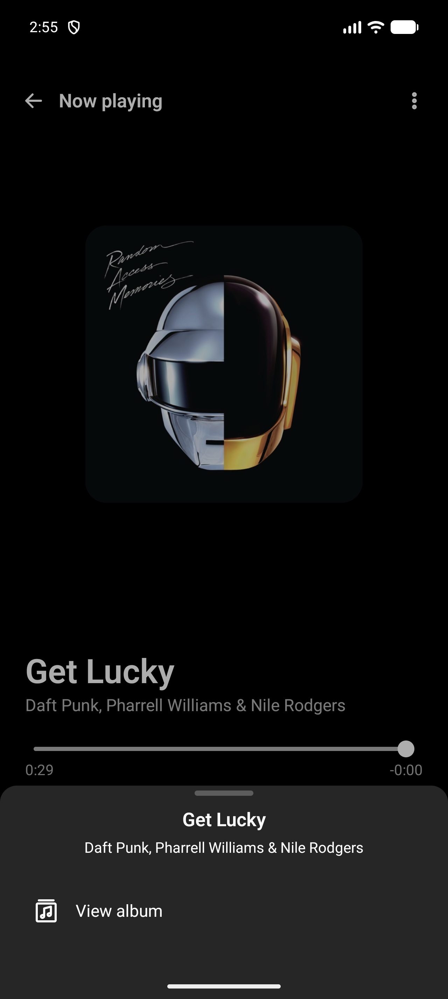
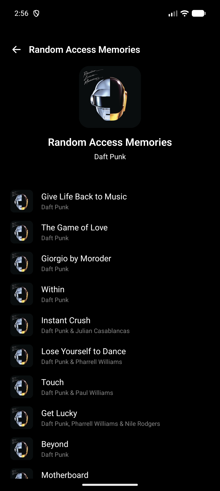

# Moises Songs

An Android phone app for searching the iTunes song catalog, streaming song previews, and exploring albums. Built for the Music AI Android code challenge with Kotlin, Jetpack Compose, MVVM, and coroutines.

## Run

```sh
git clone https://github.com/cesar1287/moises-ai-challenge.git
cd moises-ai-challenge
```

- JDK 17, Android SDK 36, and an emulator or device running Android 8.0 / API 26 or newer.
- Open the repository in Android Studio and sync Gradle. The project uses AGP 9.2.1 and Gradle 9.4.1.
- Configure `sdk.dir` in your local, ignored `local.properties` if Android Studio has not created it.
- Build and install:

```sh
./gradlew :app:assembleDebug :app:installDebug
```

The app requires no API key or account. Internet access is needed for new searches, album lookups, and preview playback. Search for a song or artist and submit with the keyboard's Search action; the welcome screen also offers a Daft Punk search. Tap a song to open its player or its three-dot menu to view the album.

Gradle's daemon JVM criteria request JDK 17, matching the Java/Kotlin compilation toolchain. Set `JAVA_HOME` and Android Studio's **Gradle JDK** to the same JDK installation to reuse the same daemon. With `GRADLE_LOCAL_JAVA_HOME`, configure the ignored `.gradle/config.properties` file's `java.home` to that installation. Android Studio itself can continue to run on its bundled JBR. Machine-specific JDK paths stay outside the shared build configuration.

## Walkthrough

1. Launch the app and tap **Try “Daft Punk”**, or enter your own search.
2. Scroll toward the bottom to load more results. Pull down to refresh.
3. Open a song, play/pause its preview, seek, and try the previous/next and repeat controls.
4. Open the three-dot menu, choose **View album**, and play a track from that album.
5. Return to Songs and clear the search to see recently played songs.
6. Turn off the device's network and restart the app. History remains available, and submitting a previously loaded search shows cached results. Restore connectivity to fetch new content and stream previews.

## Screenshots

Captured from the running app with live iTunes data:

<p>
  
  
  
  
</p>

Offline checks: [history after restarting the app](docs/screenshots/offline-history.png) and [cached search results](docs/screenshots/offline-search.png).

## Included

- Splash, Songs/Home, Now Playing, Album, and the song options bottom sheet.
- Incremental search loading, pull-to-refresh, cancellation of outdated searches, and separate pagination retry.
- Persisted search results, album tracks, and the 20 most recently played songs. Cached content stays visible while refreshing or after network failure.
- Streamed previews with play/pause, seeking, elapsed and remaining preview time, previous/next songs, and repeat. Playback pauses when the app leaves the foreground and when headphones disconnect.
- Loading, empty, connection, service, rate-limit, unavailable-preview, and playback-error states.
- English and Brazilian Portuguese, including spoken control labels and per-app language settings on Android 13+. Earlier Android versions follow the device language. Catalog titles and artist names remain API content.
- Restored navigation and search state, labeled controls, 48 dp control targets, system/keyboard insets, and a scrollable player on short screens or with enlarged text.

## Architecture

The project uses one `app` Gradle module. Clean Architecture is organized in package folders under `app/src/main/kotlin/com/example/moisessongs`:

```text
domain/     Models, repository/player contracts, failures, queue rules
data/       Room storage, Retrofit catalog, Media3 playback, implementations
ui/         Compose screens, ViewModels, UI state and theme
```

The domain folder contains plain Kotlin and depends on neither data nor UI. Data implements domain contracts; ViewModels depend on those contracts. `MainActivity`, navigation, and the application composition root connect the layers. These boundaries are maintained through package organization and imports within the single module.

`SongsApplication` provides domain contracts through a small composition root; transport/storage configuration stays inside `DataDependencies`. Constructor injection keeps dependency ownership explicit. ViewModels translate domain failures into UI messages without importing Retrofit or SQLite. Navigation 3 stores serializable destination keys and scopes feature ViewModels to back-stack entries. The player ViewModel is Activity-scoped so navigation and configuration changes share one player.

Database observations are the source of displayed catalog content. Search metadata and ordered songs are read in one joined query to avoid displaying a new page cursor alongside old results. Refreshes update songs, memberships, and pagination metadata in one transaction; failed writes roll back all changes. History records actual playback, rather than simply opening a song.

## API decisions and trade-offs

Apple's [Search API documentation](https://performance-partners.apple.com/search-api) documents a `limit` of 1–200 and no page/cursor parameter. A live check also showed `offset=25` returning the first page again. The app therefore requests prefixes of 25, 50, 75, …, 200 results, deduplicates stable track IDs, and persists each successful snapshot. Refresh requests the current prefix size. This costs repeated bytes and caps a search at 200 results; it avoids relying on a parameter the API ignores. A different catalog can implement true server pagination behind the repository contract.

Search uses explicit submission rather than a request on each keystroke. This limits unnecessary requests against Apple's rate-limited catalog. Cache keys normalize whitespace and casing. Album lookups use collection IDs and sort tracks by disc and track number. Invalid/non-song records are filtered, optional artwork and previews have fallbacks, and transport failures remain visible and retryable.

The player's timeline uses Media3's preview duration, which can differ from the full song duration in the catalog metadata. Previews are streamed without an audio disk cache. Offline support covers saved metadata, history, and artwork already cached by Coil; it does not promise offline audio. Preview attribution and an iTunes destination link appear in the player.

The phone layouts and bundled icons/splash artwork were read through Figma MCP from the [challenge design](https://www.figma.com/design/rfhCTTYLNnKPw16RF0FzjF/Code-Challenge--Copy-?node-id=11005-2008). The exported icon paths are bundled as native VectorDrawables, and the splash/placeholder artwork uses lossless WebP. Song artwork remains dynamic API content. Android supplies real system bars. The design's Articulat CF font files were not included; Android sans-serif is used with matching size and weight roles. Secondary text has slightly higher contrast. Other platform and tablet frames in the design are outside this phone challenge.

Large artwork requests use a larger size on Apple's image CDN when the returned URL has the recognized sizing suffix. If that request fails, the app falls back to the API's original artwork URL.

The cache refreshes when a search is submitted or an album is opened and supports explicit refresh. A production app could add cache eviction, expiration policies, and persisted playback queues. Background playback and a media notification would require a MediaSessionService; this challenge uses foreground preview playback.

## Validation

```sh
# Local behavior and HTTP contract tests; no emulator or live API required.
./gradlew :app:testDebugUnitTest

# Room/SQLite, real Media3 with a generated local audio fixture, and Compose journeys.
# Start an emulator or connect a device first.
./gradlew :app:connectedDebugAndroidTest

# Static checks and APK.
./gradlew :app:lintDebug :app:assembleDebug :app:assembleRelease :app:bundleRelease
```

Local tests cover prefix pagination and its cap, deduplication, cache preservation, cancellation, ViewModel recovery, history timing, queue boundaries, restoration, and HTTP request/response mapping through MockWebServer. Instrumented tests exercise SQLite rollback and reopen persistence, actual preview duration/seeking/completion/error recovery, and the search → player → sheet → album journey, Back handling, retry, and saved-state restoration. Fakes keep the automated UI suite independent of iTunes availability.

The release APK is unsigned; use debug for local installation. The release App Bundle is written under `app/build/outputs/bundle/release`. Reports are written under `app/build/reports`. Room's version-one schema is checked in under `app/schemas`. Debug unit-test coverage is enabled through AGP/JaCoCo.

## Performance

Playback position is observed only inside the timeline. It cannot invalidate navigation, artwork, or the rest of the player every 250 ms; the timeline interpolates progress locally. A regression test verifies that 100 position updates produce no new screen-level player state. List callbacks retain their identity while search text changes, and lazy rows use stable IDs and explicit content types. Compiler reports under `app/build/reports/compose` confirm that the UI composables are skippable without broad stability annotations or collection-wide equality checks.

Retrofit/OkHttp are created lazily on the catalog worker dispatcher. The Media3 engine is created only for a playable selection, and pause/release do not allocate it. Catalog mapping, merging, and cache-flow mapping/equality checks run off the main dispatcher. Recording history inserts song metadata only if it is missing, avoiding unnecessary catalog invalidation and stale queue metadata overwriting a newer refresh.

Release builds enable R8 and resource shrinking. `ReportDrawnWhen` identifies when the initial cache observation completes and navigation reaches Home. Compose compiler reports are generated under `app/build/reports/compose`.

The project contains only the app module; the separate Macrobenchmark harness has been removed. Physical-device startup and frame-time profiling remain outstanding. Previous emulator benchmark attempts were inconclusive and are documented in [the performance audit](docs/performance.md).

The [Android quality review](docs/android-quality-review.md) records accessibility/localization findings, release size measurements, and remaining manual checks. Native vector icons avoid asynchronous SVG loading, timeline labels are formatted only when their inputs change, and the lists expose refresh actions to accessibility services. Release resources include the two supported UI languages.
